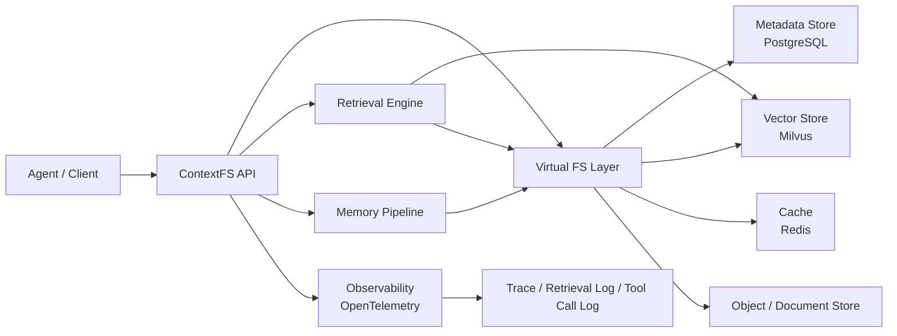
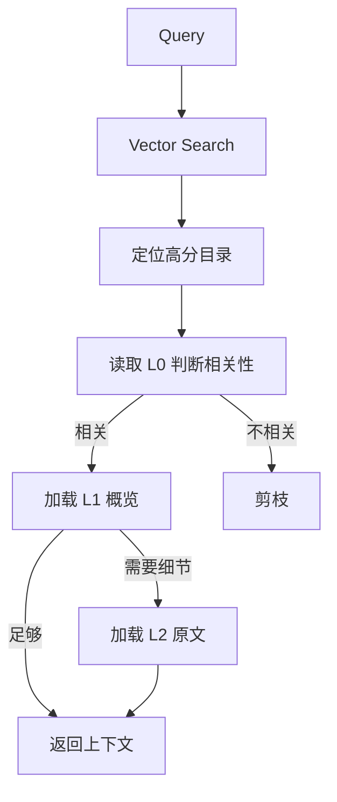
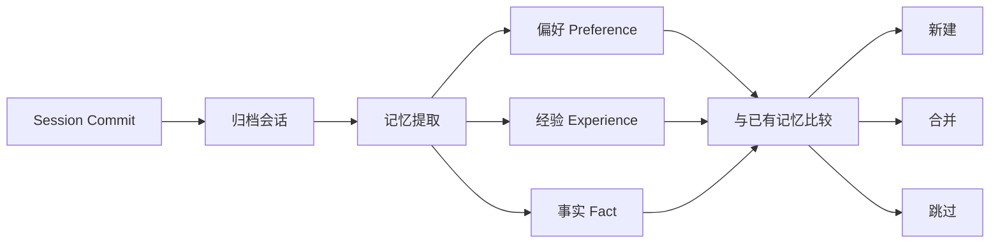

# ContextFS

> 面向多 Agent 场景的上下文统一管理平台：用虚拟文件系统组织记忆、资源与技能，通过 L0 / L1 / L2 三层按需加载降低 token 消耗。

ContextFS 是一个基于 Java 的 Agent 上下文数据库。它将 Agent 的长期记忆、知识资源、工具技能统一挂载到 `ctxfs://` 虚拟文件系统下，支持 POSIX 风格操作、目录递归检索、Session 记忆提取和全链路可观测，解决传统 RAG 扁平向量检索无法理解层级结构、无法按需加载的问题。

> 项目状态：个人项目，持续迭代中。接口与数据结构可能调整。

---

## 目录

- [核心特性](#核心特性)
- [核心概念](#核心概念)
- [系统架构](#系统架构)
- [三层加载机制](#三层加载机制)
- [目录递归检索](#目录递归检索)
- [Session 记忆提取](#session-记忆提取)
- [可观测性](#可观测性)
- [快速开始](#快速开始)
- [配置说明](#配置说明)
- [API 示例](#api-示例)
- [项目结构](#项目结构)
- [开发与测试](#开发与测试)
- [Roadmap](#roadmap)
- [贡献](#贡献)
- [License](#license)

---

## 核心特性

- **统一 URI 标识**：所有上下文以 `ctxfs://{scope}/{path}` 统一标识，支持 `ls`、`tree`、`read`、`write`、`find` 等 POSIX 风格操作。
- **三层按需加载**：目录节点自动生成 L0 摘要与 L1 概览，L2 为完整原文；检索时先匹配 L0，再按需下钻 L1 / L2。
- **目录递归检索**：先用向量检索定位高分目录，再沿目录树逐层下钻，支持 `find` 与 `search` 两种模式。
- **Session 记忆管线**：会话提交后自动归档，按偏好、经验、事实三类策略提取记忆，并执行新建 / 合并 / 跳过。
- **记忆隔离**：支持全局记忆、用户级记忆、Agent 级记忆与会话级上下文隔离。
- **全链路可观测**：通过 `traceId`、`retrieval_log`、`tool_call_log` 记录检索与工具调用的输入输出、耗时与 token 消耗。
- **Java 技术栈**：Spring Boot + LangChain4j + Milvus Java SDK + PostgreSQL + Redis + Docker + OpenTelemetry。

---

## 核心概念

### 虚拟文件系统

ContextFS 将上下文抽象为树形文件系统：

```text
ctxfs://{scope}/{path}
```

示例：

```text
ctxfs://global/skills/search/web_search.md
ctxfs://user/10001/memories/preferences.md
ctxfs://agent/coder/resources/java/concurrency.md
ctxfs://session/sess_abc123/context/turns/0001.md
```

`scope` 用于隔离上下文归属，常见取值：

| Scope | 说明 |
|---|---|
| `global` | 全局共享上下文 |
| `user/{userId}` | 用户级记忆与偏好 |
| `agent/{agentId}` | Agent 级资源与技能 |
| `session/{sessionId}` | 会话级临时上下文 |

### 节点类型

| 类型 | 说明 |
|---|---|
| `DIRECTORY` | 目录节点，挂载 L0 / L1 摘要 |
| `DOCUMENT` | 文档节点，挂载 L0 / L1 / L2 内容 |
| `MEMORY` | 记忆节点，由记忆管线生成 |
| `SKILL` | 技能节点，描述工具或能力 |

### POSIX 风格操作

| 操作 | 说明 |
|---|---|
| `ls` | 列出目录下直接子节点 |
| `tree` | 递归查看目录树 |
| `read` | 读取节点内容，可指定 `level=L0/L1/L2` |
| `write` | 写入或覆盖节点内容 |
| `find` | 按 URI / 元数据查找节点 |
| `search` | 语义检索并返回相关上下文 |

---

## 系统架构



主要模块：

- **API 层**：Spring Boot REST API，提供文件系统、检索、会话与观测接口。
- **Virtual FS 层**：解析 `ctxfs://` URI，屏蔽底层存储差异。
- **Metadata Store**：PostgreSQL 存储节点树、URI、层级关系、摘要与元数据。
- **Vector Store**：Milvus 存储 L0 / L1 / L2 向量，支持目录定位与内容检索。
- **Cache**：Redis 缓存热点目录、L0 / L1 摘要与检索结果。
- **Retrieval Engine**：目录递归检索与三层加载。
- **Memory Pipeline**：Session 归档、记忆提取、去重合并。
- **Observability**：OpenTelemetry + 结构化日志，支持链路回放。

---

## 三层加载机制

每个目录或文档节点可生成三层内容：

| 层级 | 内容 | 典型大小 | 用途 |
|---|---|---|---|
| `L0` | 摘要 | 约 100 token | 快速判断相关性 |
| `L1` | 概览 | 约 2k token | 下钻后理解结构 |
| `L2` | 完整原文 | 按需 | 最终上下文注入 |

检索流程：

```text
用户查询
  -> 向量检索匹配 L0 摘要
  -> 判断目录 / 节点相关性
  -> 按需加载 L1 概览
  -> 必要时读取 L2 原文
  -> 组装上下文返回
```

设计目标：避免一次性注入大量原文，在保持召回质量的同时显著降低 token 消耗。

---

## 目录递归检索

ContextFS 不使用纯扁平向量检索，而是采用“目录定位 + 逐层下钻”：



支持两种模式：

- `find`：偏精确查找，按 URI、路径、元数据与摘要匹配。
- `search`：偏语义检索，先定位目录，再递归下钻返回相关内容。

---

## Session 记忆提取

会话提交后触发异步记忆管线：



记忆策略：

| 类型 | 示例 |
|---|---|
| 偏好 | 用户偏好简洁回答、偏好 Java 示例 |
| 经验 | 某类问题的解决步骤、失败教训 |
| 事实 | 用户项目信息、稳定事实 |

记忆隔离：

- 全局记忆：所有 Agent 可读。
- 用户级记忆：按 `userId` 隔离。
- Agent 级记忆：按 `agentId` 隔离。
- 会话级上下文：按 `sessionId` 隔离，可归档为长期记忆。

---

## 可观测性

每次检索与工具调用记录：

- `traceId`
- `spanId`
- `sessionId`
- `agentId`
- `query`
- `retrievedUris`
- `level`（L0 / L1 / L2）
- `latencyMs`
- `promptTokens`
- `completionTokens`
- `status`
- `error`

日志表：

| 表 | 说明 |
|---|---|
| `retrieval_log` | 检索请求、命中节点、加载层级、耗时、token |
| `tool_call_log` | 工具调用输入输出、耗时、状态 |
| `trace_span` | 链路 span，支持回放 |

支持按 `traceId` 回放链路，复盘 bad case。

---

## 快速开始

### 环境要求

- JDK 21+
- Maven 3.9+
- Docker / Docker Compose
- PostgreSQL 15+
- Redis 7+
- Milvus 2.4+

### 1. 克隆项目

```bash
git clone https://github.com/<your-name>/contextfs.git
cd contextfs
```

### 2. 启动依赖服务

```bash
docker compose up -d
```

默认启动：

- PostgreSQL
- Redis
- Milvus standalone
- etcd
- MinIO

### 3. 配置环境变量

```bash
cp .env.example .env
```

按需修改 `.env`。

### 4. 启动应用

```bash
mvn spring-boot:run
```

或：

```bash
mvn clean package -DskipTests
java -jar target/contextfs.jar
```

默认 API 地址：

```text
http://localhost:8080
```

健康检查：

```bash
curl http://localhost:8080/actuator/health
```

---

## 配置说明

`application.yml` 示例：

```yaml
server:
  port: 8080

spring:
  datasource:
    url: jdbc:postgresql://localhost:5432/contextfs
    username: contextfs
    password: contextfs
  data:
    redis:
      host: localhost
      port: 6379

contextfs:
  fs:
    default-scope: global
    max-tree-depth: 8
  retrieval:
    top-k-dir: 5
    top-k-node: 10
    default-level: L0
    enable-l1-expand: true
    enable-l2-load: false
  memory:
    enabled: true
    async: true
    strategies:
      - preference
      - experience
      - fact
  milvus:
    host: localhost
    port: 19530
    collection: ctxfs_chunks

management:
  otlp:
    tracing:
      endpoint: http://localhost:4318/v1/traces
```

关键环境变量：

| 变量 | 说明 | 默认值 |
|---|---|---|
| `SERVER_PORT` | 服务端口 | `8080` |
| `POSTGRES_URL` | PostgreSQL 连接 | `jdbc:postgresql://localhost:5432/contextfs` |
| `REDIS_HOST` | Redis 地址 | `localhost` |
| `MILVUS_HOST` | Milvus 地址 | `localhost` |
| `MILVUS_PORT` | Milvus 端口 | `19530` |
| `OTEL_EXPORTER_OTLP_ENDPOINT` | OpenTelemetry 端点 | `http://localhost:4318` |
| `CONTEXTFS_MEMORY_ENABLED` | 是否启用记忆管线 | `true` |

---

## API 示例

### 写入节点

```bash
curl -X POST http://localhost:8080/api/v1/fs/write \
  -H "Content-Type: application/json" \
  -d '{
    "uri": "ctxfs://user/10001/memories/preferences.md",
    "content": "用户偏好简洁回答，代码示例优先使用 Java。",
    "type": "MEMORY",
    "generateLevels": true
  }'
```

### 读取节点

```bash
curl "http://localhost:8080/api/v1/fs/read?uri=ctxfs://user/10001/memories/preferences.md&level=L1"
```

`level` 可选：`L0`、`L1`、`L2`。

### 列出目录

```bash
curl "http://localhost:8080/api/v1/fs/ls?uri=ctxfs://user/10001/memories"
```

### 查看目录树

```bash
curl "http://localhost:8080/api/v1/fs/tree?uri=ctxfs://user/10001&depth=3"
```

### 检索

```bash
curl -X POST http://localhost:8080/api/v1/retrieval/search \
  -H "Content-Type: application/json" \
  -d '{
    "scope": "user/10001",
    "query": "用户对 Java 并发编程有什么偏好？",
    "mode": "search",
    "topKDir": 5,
    "maxLevel": "L1",
    "traceId": "trace-demo-001"
  }'
```

响应示例：

```json
{
  "traceId": "trace-demo-001",
  "mode": "search",
  "items": [
    {
      "uri": "ctxfs://user/10001/memories/preferences.md",
      "level": "L1",
      "score": 0.87,
      "content": "用户偏好 Java 示例，关注并发与性能。"
    }
  ],
  "tokenUsage": {
    "promptTokens": 320,
    "completionTokens": 0
  },
  "latencyMs": 42
}
```

### 提交 Session

```bash
curl -X POST http://localhost:8080/api/v1/sessions/sess_abc123/commit \
  -H "Content-Type: application/json" \
  -d '{
    "agentId": "coder",
    "userId": "10001",
    "messages": [
      {"role": "user", "content": "以后回答尽量简洁，代码用 Java。"},
      {"role": "assistant", "content": "好的，我会优先使用 Java 并保持简洁。"}
    ]
  }'
```

### 查询链路

```bash
curl "http://localhost:8080/api/v1/traces/trace-demo-001"
```

---

## 项目结构

```text
contextfs/
├── contextfs-api/                 # REST API 与 DTO
├── contextfs-core/                # 虚拟文件系统、节点模型、URI 解析
├── contextfs-retrieval/           # 目录递归检索与三层加载
├── contextfs-memory/              # Session 记忆提取管线
├── contextfs-observability/       # OpenTelemetry 与日志
├── contextfs-storage/             # PostgreSQL / Milvus / Redis 适配
├── contextfs-bootstrap/           # Spring Boot 启动模块
├── docker/
│   ├── docker-compose.yml
│   └── init.sql
├── docs/
│   ├── architecture.md
│   ├── retrieval.md
│   └── memory.md
├── pom.xml
└── README.md
```

---

## 开发与测试

运行单元测试：

```bash
mvn test
```

运行集成测试：

```bash
mvn verify -Pintegration
```

代码格式化：

```bash
mvn spotless:apply
```

本地调试检索：

```bash
curl -X POST http://localhost:8080/api/v1/retrieval/search \
  -H "Content-Type: application/json" \
  -d '{"scope":"global","query":"Java 并发","mode":"find"}'
```

---

## Roadmap

- [x] `ctxfs://` URI 与虚拟文件系统抽象
- [x] `ls` / `tree` / `read` / `write` / `find` 基础操作
- [x] L0 / L1 / L2 节点生成与按需加载
- [x] 目录递归检索 `find` / `search`
- [x] Session 记忆提取与新建 / 合并 / 跳过
- [x] `traceId`、`retrieval_log`、`tool_call_log`
- [ ] 更完善的权限模型与多租户隔离
- [ ] 检索结果重排与上下文预算控制
- [ ] 管理控制台
- [ ] 更多存储后端适配

---

## 贡献

欢迎提交 Issue 和 Pull Request。

1. Fork 本仓库
2. 创建分支：`git checkout -b feature/your-feature`
3. 提交变更：`git commit -m "feat: add your feature"`
4. 推送分支：`git push origin feature/your-feature`
5. 创建 Pull Request

提交前请确保：

```bash
mvn test
```

---

## License

本项目基于 [Apache License 2.0](LICENSE) 开源。

---

## 说明

ContextFS 是个人独立项目，主要用于探索 Agent 上下文管理、层级检索与记忆管线。项目中的接口、数据模型与性能数据会随迭代更新。
